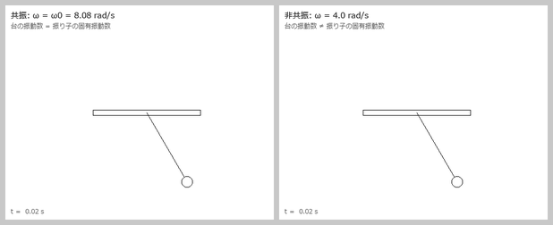

# Pendulum — 強制振動する台に吊るした振り子の共振シミュレータ

左右に振動する台から振り子を吊るし、その運動を数値計算してアニメーション表示する
C# / Windows Forms アプリです。台の振動数を振り子の固有振動数に合わせると、
振り子が**共振**して振れ幅がどんどん大きくなる様子を観察できます。

高専5年のときに、学習用として製作しました。
教科書に出てくる力学の問題（強制振動・共振）を、式で解くだけでなく
実際に動く様子として可視化してみたかったのが製作のきっかけです。



> 左: 台の角振動数 ω を振り子の固有角振動数 ω₀ ≈ 8.08 rad/s に合わせた場合（共振）。
> 右: ω = 4.0 rad/s の場合（非共振）。どちらも初期角度 30°。
> この GIF はアプリと同じ運動方程式・同じパラメータ・同じ描画方法で
> [docs/make_gif.py](docs/make_gif.py) が再計算して作ったものです。

---

## モデル

### 台（[Stand.cs](Pendulum/Stand.cs)）

台は水平方向に単振動します（単位は mm）。

$$
x_s(t) = x_0 + B \sin(\omega t), \qquad x_0 = 250,\ B = 100
$$

### 振り子の運動方程式（[EquationSolver.cs](Pendulum/EquationSolver.cs)）

台と一緒に動く座標系で見ると、振り子には重力・粘性抵抗のほかに
台の加速度による**慣性力**がはたらきます。

$$
\ddot\theta
= \underbrace{\frac{B\omega^2 \sin(\omega t)\cos\theta}{r}}_{\text{慣性力}}
\; \underbrace{-\,\frac{g}{r}\sin\theta}_{\text{重力}}
\; \underbrace{-\,\frac{k}{m}\dot\theta}_{\text{粘性抵抗}}
$$

これを**オイラー法**で解いています。タイマー 1 回（17 ms）の間に
刻み幅 h = 0.17 ms で 100 ステップ進めます。

| 記号 | 意味 | 既定値 |
|---|---|---|
| m | 錘の質量 | 0.01 kg |
| g | 重力加速度 | 9.8 m/s²（内部では ×1000 して mm/s²） |
| k | 粘性係数 | 0.0001 kg/s |
| r | 糸の長さ | 150 mm |
| θ₀ | 初期角度 | 150°（2.618 rad） |
| ω | 台の角振動数 | 8.3 rad/s |
| B | 台の振幅 | 100 mm |

固有角振動数は ω₀ = √(g/r) = √(9800/150) ≈ **8.08 rad/s** です。
既定値の ω = 8.3 rad/s は ω₀ のすぐ近くなので、共振に近い状態になっています。

---

## 使い方

1. Visual Studio で [Pendulum.sln](Pendulum.sln) を開く（.NET Framework 4.7.2）
2. ビルドして実行（ビルド済みの exe は `Pendulum/bin/Debug/Pendulum.exe`）

| ボタン | 動作 |
|---|---|
| **Start** | 初期状態からシミュレーションをやり直す |
| **Stop / Resume** | 一時停止・再開 |
| **Option** | パラメータ設定ウィンドウ（Form2）を開く |

Option ウィンドウでは質量・重力加速度・粘性係数・半径・初期角度・初期角速度を変更できます。
「送信」を押したあと、メイン画面で **Start** を押すと新しい値で計算が始まります。

実行中は Visual Studio の出力ウィンドウに `時刻,角度[rad]` が 1 行ずつ出力されます。
同梱の CSV はこの出力を保存したものです。

---

## ファイル構成

```
Pendulum/
├─ Pendulum.sln
├─ Pendulum/                 アプリ本体
│  ├─ Program.cs             エントリポイント（Form1 を起動）
│  ├─ Form1.cs               メイン画面: 描画・タイマー・ボタン、Value 構造体（系のパラメータ）
│  ├─ Form2.cs               パラメータ設定画面
│  ├─ Pendulum.cs            振り子の角度・座標を保持し、EquationSolver で次の角度を計算
│  ├─ Stand.cs               振動する台の位置と加速度
│  └─ EquationSolver.cs      運動方程式とオイラー法
├─ sample.cs                 Form1.cs の旧バージョン（Shift-JIS、ビルド対象外）
├─ docs/
│  ├─ pendulum.gif           README の GIF
│  ├─ make_gif.py            GIF を作る Python スクリプト
│  └─ experiments.py         「考察」の数値実験
└─ 計算結果のデータ（下表）
```

### データファイル

| ファイル | 内容 |
|---|---|
| `kyoushin.csv` / `.xlsx` / `.png` | 共振条件での `時刻[s], 角度[rad]` とグラフ |
| `hikyoushin.csv` / `.xlsx` / `.png` | 非共振条件での `時刻[s], 角度[rad]` とグラフ |
| `data.csv`, `data (2).csv` | 別条件で出力した `時刻[s], 角度[rad]` |
| `xa.csv` / `.xlsx` | `時刻, 台の位置 x, 台の加速度（差分による数値計算）, 台の加速度（解析解）` — 加速度の計算方法の比較 |
| `data2.csv` / `.xlsx` | 角度データのフーリエ係数（a₀, aₖ, bₖ）の計算表 |

> 共振のグラフで角度が 20 rad を超えているのは、振り子が支点の周りを
> 何周も回転しているためです（角度を ±π に折り返していません）。

---

## 考察

アプリと同じ式・同じ刻み幅で条件を変えながら計算し、気づいたことをまとめました。
数値はすべて [docs/experiments.py](docs/experiments.py) で再現できます。

### 1. 振り子の周期は振れ幅によって変わる

教科書の公式 T = 2π√(r/g) は、sin θ ≈ θ と近似できる小さな振れ幅でしか成り立ちません。
台を止めて減衰もなくし、振れ幅だけを変えて周期を測ると次のようになりました。

| 振れ幅 | 10° | 30° | 90° | 150° | 170° |
|---|---|---|---|---|---|
| 周期 / 公式の周期 T₀ | 1.00 | 1.02 | 1.18 | 1.76 | 2.44 |

振れ幅が大きいほど周期は長くなります。
アプリの既定の初期角度 150° では、公式より 76% も長くなっています。

### 2. 共振のピークは ω₀ より低い側にずれる

台の振幅を B = 2 mm と小さくし、静止した状態から 200 秒揺らしたときの最大振れ角を、
台の角振動数 ω ごとに調べました。

| ω [rad/s] | 7.0 | 7.5 | 7.8 | **7.9** | 8.0 | 8.08 (=ω₀) | 8.2 | 8.4 | 9.0 |
|---|---|---|---|---|---|---|---|---|---|
| 最大振れ角 | 4° | 9° | 23° | **59°** | 49° | 42° | 31° | 19° | 8° |

- ω₀ の近くで振れ幅が大きくなり、共振が確認できました。
- ただし、ピークは ω₀ = 8.08 ちょうどではなく、少し低い **7.9 rad/s 付近**に出ました。
  考察 1 のとおり、振れ幅が大きくなると振り子の周期が長く（固有振動数が低く）なるため、
  共振する ω も低い側にずれたと考えられます。
- 7.8 から 7.9 の間で振れ幅が急に変わっており、山の形が左右対称ではありません。
  これは非線形振動で知られる「跳躍現象」の一部かもしれません。
  確かめるには、ω を少しずつ上げる場合と下げる場合を比べる必要があります。
- 線形近似の式（sin θ ≈ θ）で計算すると、ω = ω₀ の定常振幅は
  B·ω₀ / (r · k/m) ≈ 10.8 rad（約 620°）になります。
  実際は 40〜60° 程度で頭打ちになっており、ここでも非線形性が効いています。

### 3. 既定の設定（B = 100 mm）では「共振」というより回転・カオス

台の振幅 100 mm は糸の長さ 150 mm の 2/3 もあり、揺さぶりがかなり強い設定です。

- ω = 8.08 でも 10 でも 12 でも、振り子は支点の周りを何周も回ってしまいます。
  一方、ω = 4.0 では振れ角が 0.73 rad 程度に収まります。
  [kyoushin.png](kyoushin.png) で角度が 20 rad 以上になっているのも、この回転によるものです。
- 初期角度を 30° と 30.001° にして比べると、
  10 秒後の差は 0.03 rad ですが、15 秒後には 5 rad 以上に広がりました。
  初期値のわずかな違いが大きく増幅されていて、**カオス**の特徴を示しています。

教科書どおりの共振を見たいときは、台の振幅を数 mm 程度に小さくするのがよさそうです。

### 4. オイラー法なのにエネルギーが増えなかった理由

前進オイラー法で振り子を計算すると、本来は一定のはずのエネルギーが少しずつ増えて、
振れ幅が大きくなっていくことが知られています。
ところが、このアプリの計算では振れ幅がほとんど変わりませんでした。

| 方法（台は止め、減衰なし、30° から 60 秒） | 60 秒後の振れ幅 |
|---|---|
| 前進オイラー法 | 41.4°（増えてしまう） |
| このアプリの方法 | 30.0°（保たれる） |

[EquationSolver.cs](Pendulum/EquationSolver.cs) では、先に θ を更新し、
**更新後の θ** で角加速度を計算しています。
この順番だと、エネルギーが保たれやすい
**半陰的オイラー法（シンプレクティック・オイラー法）** になります。
コードの書き順が、結果的に計算精度を良くしていました。

### 5. 台の加速度を位置の差から求めると、1000 倍ずれていた

[xa.csv](xa.csv) は、台の加速度を次の 2 通りで求めて並べたデータです。

- 位置の差から数値的に求めた値（`Stand.getA`）
- 式から求めた値（`Stand.getA2`）

| 時刻 [s] | getA（数値） | getA2（解析） |
|---|---|---|
| 0.017 | 865.1（起動直後で不正確） | −894.0 |
| 0.034 | −817.7（起動直後で不正確） | −1771.1 |
| 0.051 | −0.893 | −2614.8 |
| 0.068 | −1.768 | −3409.3 |
| 0.085 | −2.611 | −4139.6 |

getA の値は、**2 行前の getA2 の 1/1000** とほぼ一致します
（差の平均は 0.007、つまり 1000 倍に戻すと 7 mm/s² 程度）。

- 1/1000 になる理由: `getA` の中で 1000 で割っているため（mm/s² → m/s² の換算と思われる）。
  運動方程式の側は mm 単位のままなので、mode 1 で計算すると慣性力が 1/1000 になってしまいます。
- 2 行ずれる理由は 2 つあります。
  - 中心差分 (x₂ − 2x₁ + x₀)/Δt² は、3 点の真ん中、つまり 1 ステップ前の時刻の加速度を表す。
  - このデータは、台の位置を更新（`st.setValue(t)`）する前に出力している。
    そのため、位置そのものも 1 ステップ遅れている。
    x 列が t = 0.017 で初期値の 250 のままなのはこのためです。

アプリが解析式を使う mode 0 で動いているのは、このずれがあったからだと考えられます。

### まとめ

- ω₀ の近くで振れ幅が大きくなる共振を、アニメーションと数値の両方で確認できた。
- 教科書の線形モデルからは見えない現象が、数値計算では自然に現れた。
  - 振れ幅によって周期が変わる
  - 共振のピークが ω₀ より低い側にずれる
  - 強く揺さぶるとカオス的な回転になる
- 数値計算では、式だけでなく計算の順番や単位の扱いが結果に直接影響することがわかった。

---

## 補足・既知の問題

- `Form2` のフィールド初期化子 `public Form1 f = new Form1();` により、Option を開くたびに
  表示されない Form1（タイマー付き）が裏で 1 つ作られます。`public Form1 f;` にすれば解消します。
- Option で数値以外を入力して「送信」を押すと `double.Parse` で例外になります。
- 台の振動数 ω と振幅 B は `Form1.Initialize()` 内の `new Stand(250.0, 200.0, 100.0, 8.3)`
  で固定されており、Option 画面からは変更できません。
- `EquationSolver.ddfunc` には、台の加速度を解析式で与える版（mode 0、使用中）と
  位置の差分から求める版（mode 1）の 2 種類があります。
